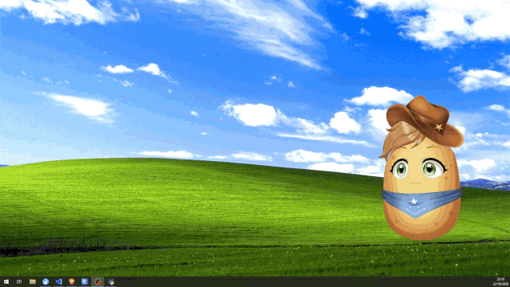

# PotaTuber

**An AI VTuber that runs on a potato.**

<!-- TODO GIF: Pota-chan floating bottom-right over a normal desktop (VS Code or a
browser open behind her), user holds a key and talks, she answers out loud with
subtitles appearing below her and her mouth moving. 10-15 seconds, looped. -->


PotaTuber is a tiny, fully local AI VTuber: she hears you through your microphone,
thinks with a small language model running on your own machine, answers in her own
voice, and shows up as a Live2D character — floating over your desktop, in a browser
tab, or inside VTube Studio. No cloud, no subscriptions, no GPU required.

She's also built to be *understood*. The whole thing is a handful of short Python
files, one per part — `ears.py`, `brain.py`, `voice.py`, `hands.py`, `eyes.py` — and
you can read all of them in an evening. If you've ever wondered how AI VTubers
actually work, this is the project that shows you, with a potato in it.

**What's in the box**

- **Push-to-talk** — hold a key, say something, she answers. Powered by Whisper.
- **Any local brain** — talks to LM Studio out of the box, or anything with an
  OpenAI-compatible API. Swap models by loading a different one in LM Studio;
  no PotaTuber changes needed.
- **Voice cloning** — give her a short recording and she speaks in that voice.
  Kyutai's Pocket TTS, running on CPU.
- **A real Live2D body** — Pota-chan comes included, but any VTube Studio model
  works: expressions, outfits, lip sync and vowel shapes, all driven by her.
- **Hands** — she can change her own expression, put on a scarf, and use any tool
  you write for her.
- **Eyes** (optional) — let her see your screen.
- **Three ways to run her** — a desktop pet that floats over your windows, a browser
  page you can drop into OBS, or as a model (or a companion sitting on *your* model)
  inside VTube Studio.

**"On a potato"?** The default setup — small Whisper, a 3B model, Pocket TTS — runs
happily on a CPU-only laptop. Some extras cost more: screen vision, the big voice
model, and VTube Studio itself all appreciate a GPU or a Mac. Each chapter says what
its knobs cost.


<details>
<summary><h2>Quickstart (Advanced)</h2></summary>

**Prerequisites**

- An OpenAI-compatible API for her brain. I recommend [LM Studio](https://lmstudio.ai/)
  with Ministral 3 3B Instruct (Q4) loaded and the local server turned on
  (Model Server tab).
- [uv](https://docs.astral.sh/uv/getting-started/installation/)
- A [Hugging Face](https://huggingface.co/) account — Pocket TTS downloads its weights from there.

**Steps**

1. Clone this repo and run `uv sync` inside it.
2. Run `uv run hf auth login`. It can log you in through the browser if you'd
   rather not paste a token.
3. Copy `config.example.toml` to `config.toml`.
4. Run `uv run python -m potatuber.server`. The first run downloads the models
   and frontend libraries, so this takes a while. Wait for `All parts ready!`,
   then Ctrl+C. After this she's fully offline.
5. Run `uv run python -m potatuber`. Pota-chan appears bottom-right. Click her
   awake, hold **right shift**, and say hello. The console is at
   [http://localhost:8158/](http://localhost:8158/).

Everything you'd want to change lives in `config.toml` — her model, voice,
personality, and how she's displayed. The rest of this README walks through each
of those. Windows and macOS are tested; on Linux she runs in browser mode
(see [Different modes](#different-modes)).

</details>

<details>
<summary><h2>Setting up from scratch (Beginner)</h2></summary>

Never used Python, a terminal, or GitHub? This chapter is for you. There are a
few pieces to put in place before she can run, so take your time. Nothing here
is hard, and most of the waiting is downloads.

**What you'll install**

- **Visual Studio Code** — a free text editor. We use it for two things: editing
  one settings file, and its built-in terminal (the window where you type commands).
- **uv** — installs Python and everything PotaTuber needs, in one command.
- **LM Studio** — runs the AI model that is her brain, on your own computer.
- A free **Hugging Face** account — her voice model is downloaded from there.

Windows and macOS are both fine. Where they differ, the step says so.

### Step 1: Install Visual Studio Code

Download it from [code.visualstudio.com](https://code.visualstudio.com/) and
install it like any other program. Open it once so it finishes setting up.

Later you'll use its terminal: in the top menu, **Terminal → New Terminal**
opens a panel at the bottom where you can type commands. Every command in this
chapter goes there.

<!-- TODO screenshot: VS Code with the terminal panel open at the bottom,
Terminal → New Terminal menu highlighted. -->


While you're here, install one extension: click the **Extensions** icon on the
left (the four squares), search for **Even Better TOML**, and hit **Install**.
Her settings file is written in TOML, and without this it shows up as plain
white text instead of being nicely colored and easier to read.

<!-- TODO screenshot: VS Code Extensions panel with "Even Better TOML" in the
search results, Install button visible. -->


### Step 2: Install uv

uv is a small program that manages Python for you. Normally running a Python
project means installing Python, then installing each library it needs, and
making sure the versions all agree. uv does all of that with one command, so
you never install Python yourself.

It doesn't come as a regular installer; instead you paste a command into the
terminal, which downloads it into your own user folder.

Open the VS Code terminal (**Terminal → New Terminal**), paste the line for
your system, and press Enter:

**Windows**

```powershell
powershell -ExecutionPolicy ByPass -c "irm https://astral.sh/uv/install.ps1 | iex"
```

**macOS**

```sh
curl -LsSf https://astral.sh/uv/install.sh | sh
```

When it finishes, **close VS Code completely and open it again** so the
terminal notices the new program. Then open a terminal and type `uv --version`.
If it prints a version number, you're good.

**Windows**

```powershell
powershell -ExecutionPolicy ByPass -c "irm https://astral.sh/uv/install.ps1 | iex"
```

**macOS**

```sh
curl -LsSf https://astral.sh/uv/install.sh | sh
```

When it finishes, **close VS Code completely and open it again** so it notices
the new program. Then open a terminal and type `uv --version`. If it prints a
version number, you're good.

### Step 3: Install LM Studio and her brain

1. Download LM Studio from [lmstudio.ai](https://lmstudio.ai/), install it, and
   go through its short introduction.
2. Click the **Model Search** tab on the left and type `Ministral 3 3B`. The
   one from Mistral themselves is at the top, marked as a staff pick. Click it.
3. On the right, under **Download Options**, pick
   **Ministral 3 3B Instruct 2512 Q4_K_M** (about 3 GB) and hit **Download**.

   <!-- TODO screenshot: LM Studio Model Search with "Ministral 3 3B" typed,
   the Mistral staff pick selected, Download Options showing Q4_K_M. -->
   

4. When it's done, go to the **Chat** tab on the left. At the top of the window,
   click **Select a model to load** and pick the Ministral you just downloaded.
5. Say hi to it. This is a complete AI language model running on your own
   computer, with no internet involved, and it's about to become her brain.
   If it answers, everything is working.
6. Now go to the **Model Server** tab on the left. Your model is already loaded
   there. At the top it says **Status: Stopped** next to a toggle; switch it on.
   The server starts on port 1234, which is what PotaTuber expects.

   <!-- TODO screenshot: LM Studio Model Server tab, Status: Running, toggle ON,
   Ministral shown as loaded. -->
   

LM Studio needs to be open with the server on whenever you run PotaTuber.
If you ever hear her say *"I can't reach my brain right now"*, this is why.

### Step 4: Make a Hugging Face account

Sign up for free at [huggingface.co](https://huggingface.co/join). That's all
for now; you'll log in from the terminal in a later step.

### Step 5: Download PotaTuber

1. On [the PotaTuber GitHub page](https://github.com/Caphalem/potatuber), click
   the green **Code** button, then **Download ZIP**.

   <!-- TODO screenshot: GitHub repo page, green Code button open, Download ZIP
   highlighted. -->
   

2. Unzip it somewhere you'll find it again, like your Documents folder. You'll
   get a folder called `potatuber-main`. Rename it to `potatuber` if you like.
3. In VS Code, **File → Open Folder** and pick that folder.

From now on, every terminal you open in VS Code starts *inside* this folder,
which is exactly where the commands need to run.

### Step 6: Install everything PotaTuber needs

Open a terminal in VS Code and run:

```sh
uv sync
```

This downloads Python and all the libraries she uses. It takes a few minutes
the first time. If it ends without red text, it worked.

> **Windows note:** you might see a warning about "hardlinking" and "different
> filesystems". It's harmless; everything still installs.

### Step 7: Log in to Hugging Face

In the terminal, run:

```sh
uv run hf auth login
```

Choose the option to log in through your browser, approve it, and come back.
You only have to do this once.

### Step 8: Create her settings file

In VS Code's file list, make a copy of `config.example.toml` and name it
`config.toml`.

This is the one file you'll edit to change her voice, personality, model and
more. The defaults are already set up for Pota-chan, so leave it alone for now.

### Step 9: First run (the slow one)

Make sure LM Studio is open with the server on, then run:

```sh
uv run python -m potatuber.server
```

The first time, she downloads her voice and hearing models and a few files for
her face. This takes a while, and the terminal tells you what's loading. When
you see:

```
All parts ready!
```

click into the terminal and press **Ctrl+C** to stop her. (Click into the
terminal first: with the editor focused, Ctrl+C just copies text.) Everything
is now saved on your computer, and from here on she works without internet.

> **macOS note:** your Mac will ask for permissions, Microphone for sure, and
> possibly Accessibility and Screen Recording. Allow them. They're granted to
> VS Code (since that's what launched her), and you may need to quit and reopen
> VS Code for them to take effect.

### Step 10: Say hello

Run:

```sh
uv run python -m potatuber
```

After a moment Pota-chan appears in the bottom-right corner of your screen.

1. Click the **Wake her up** button.
2. Hold **right shift**, say something, and let go.
3. She answers out loud, with subtitles below her.

<!-- TODO screenshot: Pota-chan awake bottom-right, subtitle visible, VS Code
terminal behind her showing the startup prints. -->


Her console, where you can type to her instead and watch the conversation, is at
[http://localhost:8158/](http://localhost:8158/). To stop her, click into the
terminal and press **Ctrl+C**. To start her again it's just the command above,
every time, with LM Studio running.

**Something went wrong?** The two most common hiccups: *"Server never came up"*
on the first run means a download took longer than expected, just run step 9
again. And *"I can't reach my brain"* means LM Studio isn't running or its
server is off. Everything else is in [Troubleshooting](#troubleshooting).

Now that she's talking, head to [How to use PotaTuber](#how-to-use-potatuber)
to learn what she can do, or jump straight to changing
[her personality](#how-to-change-her-personality).

</details>


<details>
<summary><h2>How to use PotaTuber</h2></summary>

Once she's running, there are two places you'll interact with her: the
character herself, and her console in the browser.

### Talking to her

Hold **right shift** (by default), say something, and let go. Whisper turns your words into
text, her brain thinks up a reply, and she says it out loud, one sentence at a
time, with subtitles below her. Short taps are ignored, so brushing the key by
accident won't make her listen.

She always finishes her thought. If you talk while she's still answering, your
message waits its turn and she responds to it right after.

### The character window

- **Wake her up** has to be clicked once after launch. Browsers won't play
  sound until you've clicked something, and she lives inside one.
- **Ctrl+Alt+P** (by default) switches between *solid* and *ghost* mode. Solid shows a dark
  panel behind her: you can click her, drag her around, and scroll over her to
  zoom. Ghost makes the panel vanish and clicks pass straight through her to
  whatever's underneath, so she can sit over your work, game or whatever without getting in the
  way. The subtitle window follows the same switch.
- She remembers where you dragged her and how big you made her, so next launch
  she's right where you left her.
- If you set `follow_mouse` to `true` in `config.toml`, her eyes follow your
  mouse across the whole screen.

<!-- TODO screenshot: side by side — Pota-chan in solid mode with the dark
panel visible, and in ghost mode floating over a browser window. -->


### The Console

Open [http://localhost:8158/](http://localhost:8158/) in any browser. It shows
the conversation as it happens, and lets you type to her instead of talking.

<!-- TODO screenshot: the console mid-conversation, with a tool-use line, the
status pill, the vision toggle, and the tools dropdown expanded. -->


- **The status pill** in the top left tells you what she's doing: *idle*,
  *listening* (you're holding the key), *thinking* (her brain is working), or
  *speaking*.
- **The tools dropdown** lists every ability she currently has, with the exact
  description her brain sees. If you add a tool and it isn't in this list, she
  genuinely doesn't have it.
- **Tool uses** show up in the log as grey lines: what she called, with what,
  and what she was told back. When she changes her expression or puts on a
  scarf, you'll see it here first.
- **Vision**, if you've enabled it in the config, is a switch in the top right.
  Off by default, since looking at your screen costs time; flip it on when you
  want her to see what you see. While it's on, a **What she saw** dropdown
  shows the exact screenshot sent with your last message.
- Reloading the page rebuilds the log from her memory. What you see is exactly
  what she remembers, so when old messages vanish from the top, that's her
  memory limit at work, not a bug.
- If you restart PotaTuber, the console notices, shows a banner, and reconnects
  on its own. There's a button if you're impatient.

### Stopping her

Click into the terminal and press **Ctrl+C**. Shutting down takes a few seconds.
To start her again, it's the same command as before (`uv run python -m potatuber`), with LM Studio running.

</details>


<details>
<summary><h2>How to change her VTuber model</h2></summary>

Pota-chan comes included, but any Live2D model made for VTube Studio works. If
it loads in VTS, it loads here, same files, same folder.

### Dropping in a model

1. Put the model's folder inside `frontend/models/`. The folder should contain
   a `.model3.json` file plus its textures, physics and so on, exactly as it
   came. Subfolders like `expressions/` or `animations/` are fine.
2. In `config.toml`, point `model` at the `.model3.json`:

   ```toml
   [face]
   model = "models/MyModel/MyModel.model3.json"
   ```

   The path is relative to the `frontend/` folder, which is the website's root,
   so `frontend/` itself never appears in it.

3. Restart her. She appears with the new body. Her face and voice are separate
   things, so she still sounds like whoever is in `[voice]`.

Only Cubism 3 and 4 models (`.model3.json`) are supported. Very old Cubism 2
models (`.model.json`) won't load.

> **Note:** Live2D models are usually licensed for personal use only. Models you
> download or commission are yours to run, not to redistribute, so keep them
> out of your forks. The `models` folder is ignored by git for everything
> except Pota-chan for exactly this reason.

### Making her mouth move

Her mouth is driven by her voice: the louder she is, the wider it opens. For
that to work, PotaTuber needs to know which parameter is her mouth. Most
riggers use the standard `ParamMouthOpenY`, and the default config covers the
common names:

```toml
mouth_params = ["ParamMouthOpenY", "ParamMouthOpen", "MouthOpen"]
```

If her mouth doesn't move, your rigger named it something else. Open
[http://localhost:8158/mascot/](http://localhost:8158/mascot/) in a browser,
wake her up, and press F12 to open the browser console. PotaTuber prints every
parameter the model has there. Find the one that looks like a mouth and add it
to the list.

<!-- TODO screenshot: browser console showing the "Live2D parameters:" print
with a mouth parameter highlighted. -->


Two more knobs tune how it looks:

- `mouth_gain` is how much her voice opens her mouth. This depends entirely on
  the rigging: lower it if her mouth looks stuck open, raise it if quiet words
  barely move it.
- `mouth_form_param` gives her vowel shapes. PotaTuber can't hear vowels, but
  it can hear brightness: wide "ee" sounds are bright, round "oo" sounds are
  dark. That brightness is mapped onto the mouth form parameter (-1 is round,
  +1 is wide) while she speaks. `mouth_form_range` is the brightness range in
  Hz that maps to round..wide, and it depends on her voice, not her body. If
  her mouth is always wide, lower the first number; if it's always round, raise
  the second. Set `mouth_form_param` to an empty string to turn vowel shapes
  off.

> **Note:** if her mouth freezes shut (or open) whenever she's making a face,
> that expression includes a mouth-open parameter, and expressions win. Remove
> `ParamMouthOpenY` from that expression's `.exp3.json` file and she'll talk through it.
> This is the same rule as in VTube Studio.

### Expressions

PotaTuber finds her expressions the way VTube Studio does: it scans the model
folder for `.exp3.json` files, however they're nested, and names each one
after its file. `Happy.exp3.json` becomes the expression `Happy`. Drop a new
one into the folder and she has it on the next launch.

Every expression it finds becomes a face she can make. She picks them herself,
through her `set_expression` tool, and the console shows you when she does.
A `Neutral` option is always added so she can go back to her resting face.

Since she reads the names, keep them speakable. A file called
`EXP 7 [CONFUSED].exp3.json` works, but `Confused.exp3.json` is a much better
hint for a small brain choosing a face.

### Toggles: outfits that survive her moods

Some expressions aren't emotions. Pota-chan's scarves, for example, are
expressions too, but a scarf should stay on while she smiles and frowns. Live2D
only holds one expression at a time, so without help, the scarf would vanish
the moment she made a face.

List those in `toggles`, and PotaTuber treats them as a separate layer:

```toml
toggles = ["RedScarf", "YellowScarf", "BlueScarf"]
```

Toggles stay on until she switches them off, and making a face doesn't touch
them. She gets a second tool for them, `set_toggle`, with on and off. Toggles
that can't be worn together are handled for you: Pota-chan's scarves all
change the same parts of her model, so putting on the yellow one takes the red
one off automatically. Toggles that don't overlap, like a hat and a scarf,
stack.

### Idle animation

By default she plays whatever idle motion the model defines, and if it has
none, she stands still and blinks. To use a specific motion as her idle, point
`idle_motion` at it, relative to the model folder:

```toml
idle_motion = "animations/sway.motion3.json"
```

Any looping motion works. This is also the simplest example of driving her
motions from code, if you ever want to add a `play_motion` tool: look at how
`mascot.js` swaps the idle group.

> **Note:** a custom idle owns her eyes, so she stops blinking on her own. If
> you want her to blink, record blink keyframes into the motion.

### Following your mouse

```toml
follow_mouse = true
follow_rate = 15
```

With `follow_mouse` on, she watches your cursor across the whole screen.
`follow_rate` is how many times per second she checks; lower it
if your CPU is feeling it, the head movement is smoothed either way.

### Using her in VTube Studio instead

Everything above is about the model PotaTuber renders itself. If you'd rather
she drive a model loaded in VTube Studio, that has its own setup, and the
`toggles` and `mouth_form_range` settings carry over. See
[Different modes](#different-modes).

</details>


<details>
<summary><h2>How to change her personality</h2></summary>

Her personality lives in two places: the `[character]` section of
`config.toml`, which says who she is, and the model loaded in LM Studio, which
is the brain reading it. Change either and she becomes someone else.

### Who she is

```toml
[character]
name = "Pota-chan"
system_prompt = """
You are Pota-chan, a cheerful little potato VTuber with a big country heart.
...
"""
```

`name` is what the console calls her. `system_prompt` is the character sheet
her brain reads before every conversation: who she is, how she talks, what she
cares about. Write it the way you'd describe a character to a friend, and give
examples of how she speaks. Small models imitate far better than they
interpret, so three sample phrases do more than a paragraph of adjectives.

Two things worth keeping in whatever you write:

- Tell her she can change her look with her `set_expression` tool, and whether
  to use it a lot or a little. That's personality too.
- Keep the last paragraph about the reminder. It's explained next.

### How she stays in character

Language models drift. Twenty messages into a chat, the character sheet is far
behind, and small models in particular slide back into sounding like a generic
assistant. PotaTuber fixes that with a trick:

```toml
reminder = """
This is your standard reminder on how to respond: you are Pota-chan, the
cheerful country potato VTuber. Keep your reply short ...
"""
```

The `reminder` is attached to your *latest* message every single time, right
next to where she's generating, and then removed again. It never piles up in
her memory. Because it's always close, it never fades. This is the single most
effective thing you can do to keep a small model in character over a long
conversation.

Write it as blunt instructions, not prose: how long her replies should be,
what to avoid, what she should do. Our default also tells her that her words
are spoken out loud by text-to-speech, so no emojis, no `*actions*`, and no
inner monologues. That line matters more than it looks.

If she rambles, this is where you fix it. "One to three sentences" is a
suggestion to a small model; "never more than two sentences" is a rule.

### A different girl in one file

Everything that makes her Pota-chan is in `config.toml`. Swap the `[character]`
section, point `[voice]` at a different recording, and point `[face]` at a
different model, and she's someone else entirely, same code. For a deadpan
character, for instance, a reminder of "reply with a single word or one short
sentence, flat delivery, no exclamation points" turns the same brain into
someone who answers "Rainbow." when asked her favorite color and never explains
anything.

### Which brain

```toml
[brain]
base_url = "http://localhost:1234/v1"
model = "local-model"
```

PotaTuber doesn't run the language model itself. It talks to one over the
OpenAI-compatible API, which nearly every LLM tool speaks: LM Studio, Ollama,
llama.cpp's server, and the actual cloud APIs too. That's why `brain.py` is so
short, and why you can swap brains without touching PotaTuber.

- **To try a different local model**, download it in LM Studio, load it, and
  restart her. LM Studio ignores the `model` field and uses whatever's loaded.
  Small instruct models with tool-calling support work best; Ministral 3 3B is
  the tested default, and the small Qwen3 models are a good alternative. Base
  models (ones not trained to follow instructions) don't work at all.
- **To use another server**, change `base_url` to wherever it listens.
- **To use a cloud API**, set `base_url` to the provider's endpoint, `model` to
  the model name, and `api_key` to your key. She stops being local, but she
  gets a lot smarter. (`api_key` is also where LM Studio's token goes, if you've
  turned on authentication in its server settings.)

> **Note:** if she says *"I can't reach my brain right now"*, nothing is
> answering at `base_url`. Usually LM Studio isn't open, the model isn't loaded,
> or the server toggle is off. Fix it and talk to her again; no restart needed.

### What she remembers

```toml
max_history = 24000
```

She remembers the conversation up to this many characters (roughly four per
word, or one token), and forgets the oldest exchanges first. Her character
sheet is never forgotten. The default is sized for Ministral's 8k context in
LM Studio; raise it if your model has a bigger window, lower it if replies get
slow or LM Studio starts complaining about context.

When she forgets something from an hour ago, that's not a bug. You can watch
it happen in the console, where old messages disappear from the top. That's
what a context window is.

</details>


<details>
<summary><h2>How to change her voice</h2></summary>

Her voice comes from a short recording. Give her a clip of one person talking,
and she speaks in that voice. That's Kyutai's Pocket TTS doing voice cloning on
your CPU, with no training step involved.

### Giving her a voice

1. Get a clean recording of one person speaking: no music, no other voices, no
   echo. Five to thirty seconds with some variety in it (a greeting, a question,
   a laugh) works best. Record yourself, or use a voice generator; Pota-chan's
   own voice was generated.
2. Save it into the `voices/` folder. WAV is best. MP3 works too, but its
   compression adds a little noise to the clone.
3. Point `[voice]` at it:

   ```toml
   [voice]
   sample = "voices/mine.wav"
   ```

4. Restart her. The first launch with a new sample takes a bit longer while she
   studies the voice; the result is cached next to the sample as a
   `.safetensors` file, and every launch after that is instant.

Her voice and her face are separate, so this doesn't change how she looks, and
her personality doesn't change how she sounds. If the words and the voice
don't match, that's on you to fix in one or the other.

If she's too loud or too quiet next to everything else, `volume` in `[voice]`
scales her: `1.0` is as generated, `0.5` is half. Her mouth is measured before
the volume is applied, so turning her down doesn't make her mumble visually.
Your OS mixer and OBS's source slider work too; this is just the convenient
knob.

> **Note:** the `voices/` folder is ignored by git except for Pota-chan's own
> sample. Recordings of real people, and most generated voices, aren't yours to
> redistribute.

### If she sounds crunchy

Pocket TTS is a tiny model, and tiny models clone some voices better than
others. Calm, mid-range voices come out clean. High, bright, excitable voices
(Pota-chan's, for one) tend to come out with artifacts. Two knobs help, and
they stack.

**Pitch shift**

```toml
pitch_shift = 4.0
```

The oldest trick in cartoon voice acting: clone a *lowered* copy of the
recording, where the voice sits comfortably in the model's range, then play
her back faster to lift the pitch right back up. The number is in semitones.
Three to five is the sweet spot for squeaky voices; `0` turns it off. The
lowered clip is saved next to your sample. If she sounds wrong, listen to that
file: it should sound like a perfectly natural person, just deeper. If it
sounds like a slowed-down tape, the shift is too big.

**The big model**

```toml
language = "english"
```

`english` is the small, fast model and what most machines should run.
`english_2026-09_24l` is the large "teacher" model it was distilled from.
Noticeably cleaner voices, especially the squeaky ones, but about three times
slower. Even on a fast CPU she then generates speech only barely faster than
she speaks it, so pair it with `stream_audio = false` (below) or she'll
stutter. Each model keeps its own cache next to the sample.

### Other languages

Pocket TTS speaks English, French, German, Spanish, Italian, Portuguese and
Dutch. Set `language` to one of those (add `_24l` for the big version, like
`dutch_24l`), give her a sample in that language, and write her personality in
it too. Her brain and her ears also need to understand it: Ministral is
multilingual, and the Whisper model in `[ears]` should drop its `.en` suffix
(see [How to talk to her](#how-to-talk-to-her)).

### Speed versus smoothness

```toml
stream_audio = false
```

She speaks one sentence at a time, and starts on the first sentence while her
brain is still writing the next. `stream_audio` decides how each sentence
reaches your speakers:

- `false`: the whole sentence is generated first, then played. A beat slower to
  start, but it can never stutter. The default, and the right choice for
  weaker machines.
- `true`: audio plays in tiny pieces as it's generated, so she starts talking
  sooner. If your CPU falls behind (her brain, her voice and her face are all
  working at once), playback catches up with generation and you hear gaps.

> **Note:** if she stutters, set `stream_audio = false`. If she still does,
> something else is eating your CPU; VTube Studio and a vision request are the
> usual suspects.

</details>


<details>
<summary><h2>How to talk to her</h2></summary>

Her hearing is push-to-talk: hold a key, speak, let go. The microphone is only
open while the key is held, and Whisper only runs after you release it. In
between, her ears cost nothing. That keeps the potato cool, and it means she
never mistakes your roommate, your music, or herself for you.

```toml
[ears]
hotkey = "shift_r"
whisper_model = "base.en"
prompt = "Pota-chan, PotaTuber, Live2D"
```

### The key

`hotkey` is the key you hold. It's global, so it works no matter which window
is focused, even while she floats over something else. The names come from
[pynput's key list](https://pynput.readthedocs.io/en/latest/keyboard.html#pynput.keyboard.Key):
special keys like `shift_r`, `ctrl_r` or `space`, or any plain letter like `z`.

Right shift is the default because every keyboard has one, including MacBooks,
which have no right ctrl. Quick taps are ignored, so typing a capital letter
won't make her listen. If you'd rather use a different key, just pick one you
don't hold down while using your computer.

### Which microphone

By default she listens through your system's default input. If you have more
than one microphone, set `input_device` to part of its name, like `"Yeti"`.
To see what you have, run:

```sh
uv run python -m sounddevice
```

It lists every input and output device on your machine. The name is matched
loosely, so a distinctive word from it is enough.

### How well she hears

`whisper_model` is the size of the Whisper model that turns your speech into
text. Bigger hears better but takes longer, every time you let go of the key:

- `tiny.en`, `base.en` (the default), `small.en`, `medium.en`, `large`. As
  PotaTuber is set up, Whisper runs on your CPU no matter what GPU you have
  (it's a one-line change in `ears.py` if you want to try otherwise).
  `base.en` is quick and good enough for clear speech; `small.en` is
  noticeably more accurate and still fine on most machines. `medium.en` is
  slow, and `large` is a coffee break per sentence, so only reach for those if
  you're on a fast CPU or a Mac and really need the accuracy. (`large` has no
  `.en` version; it's always multilingual.)
- Drop the `.en` for the multilingual versions (`base`, `small`), which is what
  you want if you're speaking anything other than English. Pair that with a
  matching `language` in `[voice]` and a personality written in that language.

The model downloads on first use and is cached, so switching sizes costs one
slow launch.

### Helping her with names

`prompt` is a list of words she should expect to hear. Whisper is good at
English and bad at names it's never seen: without help, "Pota-chan" comes out
as "potato Chan" or worse. Put names, jargon, and anything she keeps
mangling in here, comma-separated. Your own name is a good start. It's a
nudge, not a dictionary, so don't overdo it: a long list of words she's
primed for can make her hear them in noise.

### Typing instead

You can always type to her in the console instead of talking. Both go to the
same place, and if you do both at once, your messages just queue up in order.

</details>


<details>
<summary><h2>How to let her see your screen</h2></summary>

Optionally, she can look at your screen. When vision is on, a screenshot of
your display rides along with each message you send her, so she can
comment on what you're doing, read what you're reading, or help with what's
in front of you.

```toml
[eyes]
enabled = false
max_width = 800
monitor = 1
```

`monitor` picks which screen she looks at: `1` is your primary display, `2`
your second, and so on. `0` captures all of them side by side as one wide
image, which works but makes everything smaller for her.

### Turning it on

1. Her brain has to be able to see. Ministral 3 3B can; many small models
   can't. If you've swapped brains, check that yours supports images (LM Studio
   marks vision-capable models with a little eye icon).
2. Set `enabled = true` in `[eyes]` and restart her.
3. A **Vision** switch appears in the console. It starts *off* every launch;
   flip it on when you want her to look, and off when you don't.

The switch is there because looking costs time (more on that below). On a
CPU, you'll probably flip it on just for the moment you want her to see
something. With a good GPU behind LM Studio, you can leave it on if you want
her to see what you're doing.

> **macOS note:** the first time she looks, your Mac asks for Screen Recording
> permission. It's granted to whatever launched her (usually VS Code or
> Terminal), and you may need to quit and reopen that for it to take effect.

### What it costs

Vision is the one feature that's genuinely hard on a potato. Her brain has to
process the whole image before it can read a single word of your message, and
on a CPU that can take a long time. With a GPU in LM Studio, or on a Mac, it's
a few seconds; on a laptop CPU it can be a minute or more per message, which
is why the switch exists.

`max_width` is the biggest lever: the screenshot is scaled down to this width
before she sees it. `800` is enough to tell what app is open and roughly
what's on it. Raise it if she needs to read small text; lower it if she's
slow.

To see what she actually gets, open the console's **What she saw** dropdown
after sending a message with vision on. That's the exact image her brain
received, scaled to your `max_width`, so if you can't read something in it,
neither can she.

If you're also low on memory (16 GB with LM Studio, VTube Studio, and her all
running is tight), vision is the first thing to turn off.

### What she remembers of it

Nothing. The screenshot is attached to the one message you send, and then
gone. It's never saved to disk and never kept in her conversation memory, so
it doesn't eat into `max_history`, and she can't recall what your screen
looked like three messages ago. If you want her to look again, she looks
again.

This is the same mechanism as the `reminder` from
[How to change her personality](#how-to-change-her-personality): things that
should exist for one request only, placed right next to your latest message.

The console's **What she saw** dropdown follows the same rule: it shows the
last screenshot for as long as the page is open, and a reload clears it,
because there's nowhere to reload it from as it's not saved anywhere.

</details>


<details>
<summary><h2>How to give her new abilities</h2></summary>

Her abilities are called "tools", and the part of her that holds and runs them
is her "hands" (`potatuber/hands.py`). Out of the box she has two tools:
`set_expression` to make a face, and `set_toggle` to put on an outfit. Adding
one of your own is three steps: write a function, describe it, register it.
That's all tool calling is.

### How tool calling works

When you send her a message, her brain also gets a list of her tools, each
with a name, a description, and what arguments it takes. Instead of answering
in words, she can answer with a tool call: "run `set_expression` with
`name = Happy`". Her hands catch that, run the real Python function, and send
her back whatever it returned as plain text. She reads the result and
continues her reply, which might be more words, or another tool call.

That loop, think, call a tool, read the result, think again, is the entire
secret behind "AI agents". You can watch it happen in the console: every tool
use shows up as a grey line with the call, its arguments, and what she was
told back.

### Writing your first tool

Open `potatuber/hands.py` and find `register_custom_tools`. It's empty on
purpose: it's your sandbox, and nothing you put in it can break her built-in
tools. Add this inside it:

```python
    import random

    def roll_dice(sides: int = 6):
        return f"You rolled a {random.randint(1, sides)} on a {sides}-sided die."

    hands.register(roll_dice, {
        "type": "function",
        "function": {
            "name": "roll_dice",
            "description": "Roll a die and see what comes up.",
            "parameters": {
                "type": "object",
                "properties": {
                    "sides": {
                        "type": "integer",
                        "description": "How many sides the die has. Default 6.",
                    }
                },
                "required": [],
            },
        },
    })
```

Restart her, open the console, and check the tools dropdown: `roll_dice` is in
the list. Now ask her to roll a die. She calls the tool, the console shows the
roll, and she tells you what she got, probably with an opinion about it.

<!-- TODO screenshot: console showing "You: roll a die for me", the grey
roll_dice tool line, and her reply reacting to the number. -->


Three parts, and what each one is for:

- **The function** is ordinary Python. Arguments arrive as keyword arguments
  with the names from the schema. It returns a string: that string is what she
  "learns" happened, so write it for her, not for a log file. "You rolled a 4"
  reads better to a brain than `4`.
- **The schema** is the description her brain reads. This is the part that
  decides whether she uses the tool well. The `description` is your one
  sentence to explain what it's for; the argument descriptions tell her what to
  put where. If she keeps calling a tool wrong, the fix is almost always
  clearer wording here, not code.
- **`hands.register`** wires them together. The name in the schema is what she
  calls it by, and her hands look the function up by that name.

### Reaching her face

A tool can also talk to the browser, which is how `set_expression` changes
her face. Instead of returning just a string, return a string and a list of
events:

```python
    from potatuber.events import SetExpression

    def celebrate():
        return "You are now celebrating.", [SetExpression(name="Happy")]
```

The string goes to her brain as before; the events go to her face (or to
VTube Studio, in that mode) the moment the tool runs. The events she
understands are in `potatuber/events.py`, and that file is also where you'd
add a new one if your tool needs the browser to do something it can't yet.
Every page ignores events it doesn't recognise, so a new event can't break
anything.

For a fuller example, read `register_default_tools` in the same file. It's
her built-in tools, and it shows two slightly more advanced things: building
a tool's options at runtime (the list of faces comes from whatever model is
loaded), and returning events alongside the text.

### Tell her what she has

The schemas go to her brain with every request, so she always knows a tool
exists. Knowing and *reaching for it* are different things, though, and small
brains need a nudge. A line in her `system_prompt` like "You have a die, roll
it when someone asks for a random number or wants to settle a bet" does more
than any amount of schema polish.

### When she fumbles

She will. Small models sometimes call a tool that doesn't exist, forget a
required argument, or produce broken JSON. None of that crashes anything:
every mistake comes back to her as an error message in plain words, she reads
it, and usually tries again. Your own function's errors are caught the same
way, so a tool that throws becomes "Error: ..." in her hands rather than a
dead potato. Write functions that fail with a clear message and she'll cope.

If she never uses a tool at all, check the console's tools dropdown first: if
it isn't listed, she doesn't have it, and the usual reason is a typo between
the schema's `name` and what you expected.

### Ideas

A few tools that are small to write and fun to have, roughly in order of
effort: the current time or date; a random choice from a list you give her; a
note she can save to a file and read back; a `play_motion` tool that plays one
of her model's animations (the idle override in `mascot.js` already shows how
a motion gets loaded, so it's a short walk from there); a web search, which
needs the internet, so she's no longer fully local while she uses it.

</details>


<details>
<summary><h2>Different modes</h2></summary>

Her brain, voice, ears and hands are always the same. What changes between
modes is her *body*: where she's drawn and who draws her. There are four ways
to run her, and everything else in this README applies to all of them.

| Mode | Who draws her | Best for |
|---|---|---|
| Desktop mascot | PotaTuber, in a floating window | A companion while you work or play. The default. |
| Browser & OBS | PotaTuber, in a browser tab | Streaming with OBS, Linux, or anything that isn't Windows/macOS. |
| VTube Studio: her body | VTube Studio | She *is* your VTuber, and you want VTS's items, physics, and tracking setup. |
| VTube Studio: your companion | VTube Studio | You're the VTuber; she sits on your head and chats. |

The console at [http://localhost:8158/](http://localhost:8158/) works the same
in every mode, and so does the subtitle page at [http://localhost:8158/subtitles](http://localhost:8158/subtitles).

### Desktop mascot

```sh
uv run python -m potatuber
```

She appears as a frameless window floating over everything, with a separate
subtitle window below. This is the mode [How to use PotaTuber](#how-to-use-potatuber)
describes: wake her up, drag her where you like, toggle ghost mode with **Ctrl+Alt+P**
(by default), hold the key to speak.
Where she starts and how big her windows are live in `[mascot]` and `[subtitles]`:

```toml
[mascot]
width = 500
height = 650
x = 1120
y = 182
toggle_hotkey = "<ctrl>+<alt>+p"
```

Positions are remembered once you drag a window, and saved positions win over
these numbers. Delete `positions.json` to go back to the config's defaults.

Her size on screen isn't a config setting: scroll over her in solid mode to
zoom, and she remembers it. The window is just the frame she's drawn in, so
make it big enough for the size you like, or she gets clipped at the edges.

> **Note:** everything in `[mascot]` and `[subtitles]` is in *logical* pixels:
> what your screen is at 100% scaling. On a 1920x1080 screen at 125% scaling,
> the screen is 1536x864 logical pixels, a 500-wide window is 625 real pixels,
> and a window at `y = 940` is off the bottom edge. If a window seems to
> vanish, that's why; use smaller numbers.

Windows and macOS are supported. On Windows the window is a chroma-keyed
trick; on macOS it's real transparency. On Linux there's no mascot window yet,
so she falls back to the next mode on her own.

### Browser & OBS

```sh
uv run python -m potatuber --headless
```

No windows at all: she runs as a local website, and you open her in a browser.
Her face is at [http://localhost:8158/mascot/](http://localhost:8158/mascot/)
and the subtitles at [http://localhost:8158/subtitles/](http://localhost:8158/subtitles/).
Both pages have transparent backgrounds, which makes them perfect
**OBS browser sources**: add the two URLs as sources, and you've got a talking
Live2D character and synced subtitles in your stream with nothing else
installed. This is also the mode she runs in on Linux.

The face page still needs its wake-up click (OBS's "Interact" button does it),
and push-to-talk keeps working from anywhere, since it's a global hotkey.

> **Note:** if she shows up as a black silhouette, your browser is a privacy-
> hardened one (Librewolf, Mullvad, Tor) that lies about WebGL limits. See
> [Troubleshooting](#troubleshooting).

### VTube Studio: her body

Instead of drawing her itself, PotaTuber drives whatever model is loaded in
VTube Studio: her mouth, her vowel shapes, her expressions and outfits. You
get everything VTS offers (its physics, items, scenes, and a whole ecosystem of
models) and PotaTuber becomes just the brain behind it. Nothing in VTS has to
know about her; it only sees a plugin.

```toml
[vts]
enabled = true
mode = "model"
```

**Setting it up**

1. In VTube Studio, open the settings and turn on **Allow Plugin API access**
   (it's under the plugins section). Leave the port at 8001.
2. Load the model you want her to be.
3. Run PotaTuber. VTS pops up a permission request for a plugin called
   PotaTuber; click **Allow**. The token is saved to `vts_token.json` so
   you're only asked once.

That's it for most models. Her voice drives the standard `MouthOpen` and
`MouthSmile` inputs, which nearly every model already maps, so her mouth moves
without any rigging changes. Her expressions come from VTS's own list, named
after their files like everywhere else, and `toggles` in `[face]` works the
same way here.

<!-- TODO screenshot: VTube Studio with the API toggle on, the PotaTuber plugin
permission dialog visible. -->


`mouth_gain` in `[vts]` tunes how far her mouth opens, and it depends on the
model: VTS's own sample models want a lower number than Pota-chan does. The
`mouth_form_range` from `[face]` carries over as is, since brightness is about
her voice, not her body.

In VTube Studio mode Python plays her voice itself, so `output_device` in
`[vts]` picks which speaker it comes out of; empty means your system default.
Same name matching and same lister as `input_device` in
[How to talk to her](#how-to-talk-to-her). In the mascot and browser modes the
browser plays her, so use your OS's per-app audio settings there instead.

With no mascot window to click, there's no wake-up step. The subtitle page
still works, so an OBS browser source pointed at
[http://localhost:8158/subtitles/](http://localhost:8158/subtitles/) gives you
subtitles under your VTS capture.

> **Note:** when PotaTuber connects, you'll often see "VTS not answering,
> retrying" a couple of times in the terminal. VTube Studio is busy while her
> other parts load; it answers on the second or third try.

> **Note:** this is the mode that isn't potato-friendly. VTube Studio is a full
> 3D engine rendering at 60 frames a second, and running it alongside
> LM Studio, Whisper and Pocket TTS on one laptop CPU makes everything slower.
> It's meant for people who already run VTS, so the cost was already being
> paid.

### VTube Studio: your companion

This is the mode for VTubers who want their own AI sidekick: you stay the
model, and she becomes a Live2D *item* pinned to you, sitting on your head or
your shoulder, talking and making faces while your own tracking stays
untouched. Think of the streamer with a tiny character perched on their
model.

```toml
[vts]
enabled = true
mode = "item"
item_name = "Pota-chan"
```

It takes a bit of ceremony, all of it one-time, and it has to happen in this
order:

1. Set `mode = "item"` and **run PotaTuber once**, with VTS open and the API
   allowed. She'll say the item isn't in the scene yet, which is fine: the
   point of this run is that VTS now has two new tracking inputs called
   `PotaTuberMouth` and `PotaTuberMouthForm`. Stop her.
2. In VTS, load her model (Pota-chan, or whoever) as the *main* model, the
   normal way.
3. In its parameter settings, change the input for its mouth-open parameter
   (`ParamMouthOpenY`) from `MouthOpen` to `PotaTuberMouth`, and its mouth form
   (`ParamMouthForm`) to `PotaTuberMouthForm`. This is what keeps her off
   *your* lip sync: nothing else in VTS listens to those inputs.

   While you're here, decide what her head does. Leave the angle parameters on
   `FaceAngleX/Y/Z` and she nods along with you; set them to nothing and she
   does her own thing (an idle animation looks best for this).

   <!-- TODO screenshot: VTS parameter settings with ParamMouthOpenY mapped to
   PotaTuberMouth highlighted. -->
   

4. Set up her expression hotkeys in VTS as usual, then clear their key
   bindings, or you'll type her faces on and off all day. Easier: after
   step 6, turn off **Use normal hotkey triggers** on the item instead.
5. In the items menu, choose **Load current model as Live2D Item**.
6. Load *your* model back, load her as an item, and pin her wherever you want
   her. VTS remembers the scene.
7. Run PotaTuber again. Talk to her.

`item_name` is her folder name in VTS's `Items` folder, which is usually the
model's folder name. If she starts up but her expressions are missing from
the console's tools dropdown, the terminal prints the item names VTS can
see; that's the first thing to check.

To change her later (a new expression, a different idle), load her as the main
model again, adjust, and convert to an item again. The new item replaces the
old one.

> **Note:** items only expose expressions through hotkeys, and hotkeys toggle.
> PotaTuber keeps track of what it switched on, but if VTS still has one of
> her outfits on from a previous session, her first "put it on" will take it
> off instead. Start with her outfits off, or just ask twice.

> **Note:** a model with a *built-in* mascot (a little character rigged into
> your own model) can do something similar without items: set `mouth_param`
> and `mouth_form_param` in `[vts]` to the PotaTuber inputs, map just the
> mascot's mouth to them, and list only the mascot's expressions in
> `expressions` so she never touches your face. See the comments in
> `config.toml`.

</details>


<details>
<summary><h2>Troubleshooting</h2></summary>

- Her mouth doesn't move, or freezes while she's making a face:
  [How to change her VTuber model](#how-to-change-her-vtuber-model)
- She doesn't blink with a custom idle animation: same chapter
- *"I can't reach my brain"*, or she says her API key is wrong:
  [How to change her personality](#how-to-change-her-personality)
- Her audio stutters, or her voice sounds crunchy:
  [How to change her voice](#how-to-change-her-voice)
- Vision is painfully slow: [How to let her see your screen](#how-to-let-her-see-your-screen)
- She doesn't use a tool you added: [How to give her new abilities](#how-to-give-her-new-abilities)
- A window is off-screen, VTube Studio keeps "not answering", or her first
  outfit toggle does the opposite: [Different modes](#different-modes)

### "Server never came up" on the first run

The launcher waits two minutes for her parts to load before giving up. On the
very first run that also includes downloading the Whisper and Pocket TTS
models, which on slow internet takes longer than that. Nothing is broken; the
downloads resume where they left off. Run `uv run python -m potatuber.server`
once on its own, which has no time limit, wait for `All parts ready!`, and
launch normally after that.

### She appears as a black silhouette

Her shape is there but she's solid black. This happens in privacy-hardened
browsers (Librewolf, Mullvad Browser, Tor Browser) that deliberately lie
about what your graphics card can do, so websites can't fingerprint it. Part
of that lie is claiming a tiny maximum texture size, and most Live2D models
use 4096 pixel textures, which get refused. No texture, black potato.

The desktop mascot window isn't affected. For the browser pages, either use
a regular browser, or tell yours to be honest with localhost: in Librewolf,
open `about:config`, find `privacy.resistFingerprinting.exemptedDomains`, and
set it to `localhost, 127.0.0.1`. Everything else keeps its protection.

### macOS quirks

She works well on Macs (unusually well, in fact: Apple Silicon is fast at
exactly the kind of work she does). A few things are just different there:

- **Permissions go to whatever launched her.** Microphone, Accessibility (for
  the push-to-talk key) and Screen Recording (for vision) are granted to
  VS Code or Terminal, not to PotaTuber. The first run asks; you'll usually
  need to quit and reopen that app for the permission to take effect.
- **A "not trusted" warning about pynput** may keep appearing in the terminal
  even after you've granted Accessibility. If the key works, ignore it.
- **Dragging her windows takes two clicks**: one to focus the window, one to
  drag. That's how macOS treats inactive windows.
- **Ctrl+C sometimes hangs** on the way out, and may print a warning about
  leaked semaphores. Both are harmless. If she won't quit, close the terminal
  tab.

### Something else

Run her with `uv run python -m potatuber.server` instead of the usual command.
That skips the windows and prints everything to the terminal, including the
exact error if one of her parts fails to load. Most problems name themselves
there.

</details>


<details>
<summary><h2>Credits & license</h2></summary>

PotaTuber is a small project standing on a lot of other people's work.

### Her parts

- **Ears:** [Whisper](https://github.com/openai/whisper) by OpenAI, running
  through [faster-whisper](https://github.com/SYSTRAN/faster-whisper).
- **Brain:** whatever you load, but she was built and tested with
  [Ministral 3](https://mistral.ai/) by Mistral AI, served by
  [LM Studio](https://lmstudio.ai/).
- **Voice:** [Pocket TTS](https://github.com/kyutai-labs/pocket-tts) by Kyutai.
- **Face:** [pixi-live2d-display](https://github.com/guansss/pixi-live2d-display)
  on top of [PixiJS](https://pixijs.com/), with the
  [Live2D Cubism SDK](https://www.live2d.com/en/sdk/about/) underneath.
- **Body:** [pywebview](https://pywebview.flowrl.com/) for the desktop windows,
  the [VTube Studio API](https://github.com/DenchiSoft/VTubeStudio) for the
  rest.
- **Everything in between:** [FastAPI](https://fastapi.tiangolo.com/),
  [pynput](https://github.com/moses-palmer/pynput), and
  [uv](https://docs.astral.sh/uv/).

### Pota-chan

Pota-chan's Live2D model was designed and rigged by
[Seina Leora](https://vgen.co/SeinaLeora). Her voice was generated. Her
personality is in `config.toml` for you to read.

Her model is included with the artist's agreement so PotaTuber works out of
the box. It remains Seina Leora's work: use it with PotaTuber and your own
forks of it, but don't redistribute it on its own, sell it, or use it for
other characters.

### License

PotaTuber's code is released under the [MIT License](LICENSE). Do what you
like with it; a mention is appreciated but not required.

Two things in the repo aren't MIT:

- **Pota-chan's model**, as described above.
- **Live2D Cubism Core** (`frontend/vendor/live2dcubismcore.min.js`) isn't in
  the repo at all. It's downloaded from Live2D's own server on first run and
  is covered by Live2D's
  [proprietary software license](https://www.live2d.com/en/sdk/license/),
  which is free for small projects. The same goes for any Live2D model you
  add yourself: those are yours to run, not to share.

This is a personal project. Fork it, bend it, rename her, make her yours.

</details>